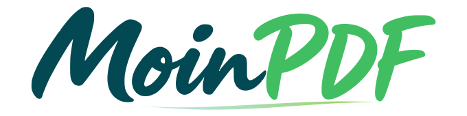

<p align="center">
  <strong>Deutsch</strong> · <a href="README.en.md">English</a>
</p>

<p align="center">
  <picture>
    <source media="(prefers-color-scheme: dark)" srcset="public/branding/moinpdf-wordmark-dark.svg">
    
  </picture>
</p>

<p align="center"><strong>Papierkram. Läuft.</strong></p>

<p align="center">
  <a href="https://github.com/MoinPDF/moinpdf/releases/latest"></a>
  <a href="https://github.com/MoinPDF/moinpdf/actions/workflows/docker.yml"></a>
</p>

<p align="center">
  <a href="#schnellstart">Installieren</a> ·
  <a href="#was-du-mit-moinpdf-erledigen-kannst">Funktionen</a> ·
  <a href="#dokumentation">Dokumentation</a> ·
  <a href="#medien-und-kontakt">Medien &amp; Kontakt</a>
</p>

<p align="center">
  
</p>

MoinPDF ist eine Webanwendung zum Erstellen, Bearbeiten und Umwandeln von PDFs und anderen Dokumenten. Dateien lassen sich zusammenführen und aufteilen, Seiten neu ordnen, Texte und Bilder bearbeiten sowie Formulare ausfüllen. Weitere Funktionen umfassen Texterkennung für Scans, Dokumentvergleiche, Rechnungsprüfungen und die Verarbeitung mehrerer Dateien im Stapel. Viele Werkzeuge arbeiten lokal im Browser. Eine Installation mit Docker ergänzt erweiterte Dateiumwandlungen, Dokumentübersetzungen und die Erstellung von Hörbüchern aus PDFs.

## Was du mit MoinPDF erledigen kannst

| Dein Vorhaben | Passende Werkzeuge |
| --- | --- |
| **Seiten in Ordnung bringen** | Zusammenfügen, teilen, drehen, sortieren, zuschneiden, nummerieren, Lesezeichen und Posterdruck |
| **PDFs bearbeiten** | Texte und Originalobjekte, Absätze mit Vorschau, Bilder, Notizen, Markierungen, Schwärzungen und Formulare |
| **Scans lesbar machen** | OCR mit 21 Sprachen, bis zu acht kombiniert, durchsuchbare PDFs, Scanverbesserung und Kamerascanner |
| **Dateien umwandeln** | Bilder, Text, Tabellen und lokales Office; mit Server zusätzlich erweiterte Office-Formate, E-Mails und Website-Links |
| **Inhalte überprüfen** | Text- und Bildvergleich, Zahlen, Rechenprüfung, Dokumentlücken und Berichte mit Fundstellen |
| **Rechnungen verarbeiten** | UBL/CII lesen, PDF und XML abgleichen; mit Server KoSIT-XRechnung-Prüfung und ZUGFeRD-Assistent |
| **Wiederholungen abkürzen** | Stapel, gespeicherte Abläufe, Belegfelder, Formularrückläufe und Dokumentchronologie |
| **Mehr aus Dokumenten machen** | Ebenen, Maßband und lokale Projekte; mit Server PDF-Übersetzung und Hörbücher |

Den genauen Umfang und die jeweiligen Grenzen findest du unter [Funktionen](docs/FUNKTIONEN.md) und [Ausbaustand](docs/AUSBAUSTAND.md).

## Schnellstart

Du brauchst **Docker Engine mit Compose v2 oder Docker Desktop**, zunächst Internet sowie als Ausgangspunkt **8 GB verfügbaren RAM und 20 GB freien Plattenplatz**.

```bash
git clone https://github.com/MoinPDF/moinpdf.git
cd moinpdf
docker compose up -d --build
```

Öffne anschließend **[localhost:8080](http://localhost:8080)**. Die Web-App, der Dokumentenserver, der Website-Konverter und die Übersetzung werden gemeinsam eingerichtet. Für den Standardstart sind weder eine `.env` noch manuell eingetragene API-Schlüssel nötig. Beim ersten Start werden Programme und Sprachmodelle geladen; das kann einige Minuten dauern.

**[Vollständige Docker-Anleitung →](DOCKER.md)** · [HTTPS und Kamera](DOCKER.md#https-und-kamera) · [Updates und Daten](DOCKER.md#updates-neustart-und-daten)

## Ein Arbeitsplatz für den ganzen Ablauf

1. **Öffnen:** PDFs, Bilder oder Rechnungs-XML hinzufügen, alternativ mit einem Beispieldokument starten.
2. **Bearbeiten:** Schnellzugriff oder Suche nutzen. Dateiname, Seitenzahl und Größe bleiben in der Dokumentübersicht sichtbar; die Werkzeugseitenleiste lässt sich bei Bedarf öffnen.
3. **Prüfen und mitnehmen:** Ergebnis herunterladen oder direkt als neues Arbeitsdokument übernehmen. Auf Smartphones stehen die wichtigsten Aktionen in einer kompakten Leiste bereit.

Mit **Projekten** sicherst du bis zu fünf Arbeitsstände lokal, einschließlich Originaldateien und Bearbeitungsverlauf. Eine `.moinpdf`-Projektdatei überträgt den Stand auf ein anderes Gerät. Browser-Projekte und Projektarchive sind unverschlüsselt und enthalten auch Originale sowie frühere Bearbeitungen; zum Weitergeben fertiger Dokumente die Ergebnisdatei verwenden.

## Wo deine Dokumente verarbeitet werden

| Betriebsart | Verarbeitung |
| --- | --- |
| **Browserwerkzeuge** | Auf deinem Gerät. Programmdateien und OCR-Sprachdaten werden vom gleichen Ursprung geladen. |
| **Serverwerkzeuge** | Nach dem Start eines Auftrags auf deiner MoinPDF-Installation. Vorgeschaltete Proxys können auf dem Übertragungsweg liegen. |
| **Website zu PDF** | Der separate Website-Konverter ruft die öffentliche Adresse ab. Die Anmeldung und Cookies deines Browsers werden nicht übernommen. |

Ein statischer Web-Build stellt selbst keinen laufenden Dokumentenserver bereit. Für den vollständigen Funktionsumfang verwende die Docker-Installation. Wichtige Ergebnisse am Original kontrollieren; Änderungen an PDFs können vorhandene digitale Signaturen ungültig machen.

## Dokumentation

In der App öffnet **Dokumentation** das durchsuchbare Handbuch mit Anleitungen zu allen 112 Werkzeugen, Direktlinks und Druckansicht. Hier im Repository findest du die technischen Anleitungen in beiden Sprachen:

| Thema | Deutsch | English |
| --- | --- | --- |
| Installation, HTTPS und Betrieb | [Docker](DOCKER.md) | [Docker](DOCKER.en.md) |
| Werkzeuge und Grenzen | [Funktionen](docs/FUNKTIONEN.md) | [Features](docs/FEATURES.en.md) |
| Umgesetzte und offene Funktionen | [Ausbaustand](docs/AUSBAUSTAND.md) | [Implementation status](docs/STATUS.en.md) |
| Office lokal im Browser | [Browser-Office](docs/BROWSER-OFFICE.md) | [Browser Office](docs/BROWSER-OFFICE.en.md) |
| Separater Dokumentenserver und API | [Server](server/README.md) | [Server](server/README.en.md) |
| Einrichtung, Tests und Releases | [Entwicklung](docs/ENTWICKLUNG.md) | [Development](docs/DEVELOPMENT.en.md) |
| Prüfungen und ihre Aussagekraft | [Validierung](VALIDATION.md) | [Validation](VALIDATION.en.md) |
| Versionsgeschichte | [Änderungen](CHANGELOG.md) | [Changelog](CHANGELOG.en.md) |
| Rückmeldungen und Beiträge | [Mitwirken](CONTRIBUTING.md) | [Contributing](CONTRIBUTING.en.md) |
| Sicherheitslücken melden | [Sicherheit](SECURITY.md) | [Security](SECURITY.en.md) |
| Projektweiter Lizenzstatus | [Lizenzhinweis](LICENSE) | [License notice](LICENSE.en.md) |

**[Neueste Veröffentlichung](https://github.com/MoinPDF/moinpdf/releases/latest)** · [Alle Releases](https://github.com/MoinPDF/moinpdf/releases) · [Aktuelle Prüfläufe](https://github.com/MoinPDF/moinpdf/actions)

## Entwickeln und mitwirken

Der Browser-Arbeitsplatz verwendet React und TypeScript, PDF.js, pdf-lib und Tesseract. Die Docker-Dienste ergänzen unter anderem LibreOffice, Ghostscript, KoSIT, veraPDF und LibreTranslate. Installation, Komponentenhinweise und Prüfabläufe stehen im [Entwicklungsleitfaden](docs/ENTWICKLUNG.md).

Fehler und Ideen kannst du über die **[deutschen oder englischen Issue-Vorlagen](https://github.com/MoinPDF/moinpdf/issues/new/choose)** melden. Bitte künstliche Beispieldateien verwenden. Für Sicherheitsmeldungen gilt der vertrauliche Kontakt in [SECURITY.md](SECURITY.md).

## Medien und Kontakt

Banner, Wortmarken, der Clip „Drucker über Bord?“ und Downloadpakete sind im **Medienbereich der App** verfügbar. Die Dateien liegen unter [public/media](public/media), der Katalog unter [media/banner-catalog.json](media/banner-catalog.json). Die [Nutzungshinweise](public/media/moinpdf-nutzung.txt) beschreiben die erlaubte Verwendung der Pressematerialien.

- Fragen und Rückmeldungen: **[ahoi@moinpdf.de](mailto:ahoi@moinpdf.de)**
- Datenschutz und vertrauliche Sicherheitsmeldungen: **[post@moinpdf.de](mailto:post@moinpdf.de)**

## Lizenzstatus

Der Quellcode ist öffentlich einsehbar. Das Gesamtprojekt hat **keine pauschale Open-Source-Lizenz**; maßgeblich ist [LICENSE](LICENSE). Ausdrücklich lizenzierte Dateien und Drittanbieterkomponenten behalten ihre jeweiligen Rechte und Lizenzhinweise.

---

<p align="center">
  <br>
  <strong>MoinPDF · Papierkram. Läuft.</strong><br>
  <a href="README.en.md">Read this page in English</a>
</p>
