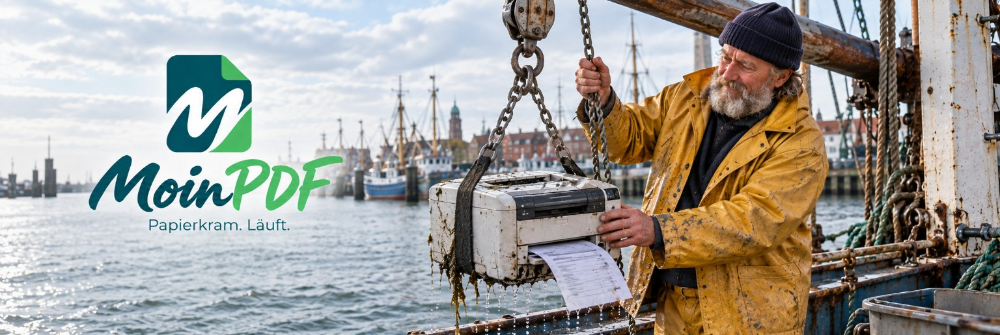

<p align="center">
  
</p>

<h1 align="center">MoinPDF</h1>

<p align="center">
  <strong>Dein PDF-Arbeitsplatz. Mit norddeutscher Gelassenheit.</strong><br>
  Bearbeiten, erkennen, konvertieren und prüfen. In einer deutschsprachigen Oberfläche.
</p>

<p align="center">
  <a href="#funktionen">Funktionen</a> ·
  <a href="#schnellstart">Schnellstart</a> ·
  <a href="#dokumentation">Dokumentation</a> ·
  <a href="#medienbereich">Medienbereich</a> ·
  <a href="#entwicklung">Entwicklung</a>
</p>

---

## Moin. Was möchtest du tun?

PDFs zusammenfügen, einen Scan durchsuchbar machen oder Rechnungsangaben vergleichen: MoinPDF bringt die passenden Werkzeuge an einen gemeinsamen Arbeitsplatz. Ziehe deine Dateien ins Fenster und beschreibe, was du vorhast. Die Suche versteht auch Formulierungen wie „Seiten drehen“ oder „PDF kleiner machen“.

Viele Aufgaben erledigt MoinPDF direkt im Browser. Die vollständige Installation ergänzt einen eigenen Dokumentenserver für aufwendige Konvertierungen, Prüfungen, Übersetzungen und Audioexporte.

## Funktionen

| Vorhaben | Das bietet MoinPDF |
| --- | --- |
| **Seiten in Ordnung bringen** | Zusammenfügen, teilen, drehen, sortieren, zuschneiden, nummerieren und mit Lesezeichen versehen. |
| **PDFs bearbeiten** | Text ersetzen, Inhalte entfernen, Bilder und Notizen einfügen, markieren, schwärzen und Formulare bearbeiten. |
| **Scans lesbar machen** | Deutsche und englische OCR, durchsuchbare PDFs, Scanverbesserung, Komprimierung und Kameraimport. |
| **Dateien umwandeln** | Bilder, Text und Tabellen exportieren; mit Dokumentenserver auch Office-Dateien, E-Mails und weitere Formate konvertieren. |
| **Dokumente prüfen** | Text- und Bildvergleich, Zahlenvergleich, Rechenprüfung, Dokumentlücken und Fundstellen im Original kontrollieren. |
| **E-Rechnungen bearbeiten** | UBL/CII lesen und Rechnungsbild mit XML abgleichen; mit Dokumentenserver XRechnung validieren und den ZUGFeRD-Assistenten nutzen. |
| **Wiederkehrendes erledigen** | Stapelverarbeitung, gespeicherte Abläufe, Belegfelder sammeln, Formularrückläufe auswerten und Dokumente chronologisch ordnen. |
| **Mehr aus Dokumenten machen** | PDF-Maßband und Ebenenverwaltung; mit Dokumentenserver lokal übersetzen und als Hörbuch ausgeben. |

Die [Funktionsübersicht](docs/FUNKTIONEN.md) erklärt die Werkzeuge, Ausgabeformate und ihre Grenzen. Schrittfolgen für jedes Werkzeug findest du in der **Dokumentation** innerhalb der App.

## Vom Dokument zum Ergebnis

1. **Dateien ablegen.** PDFs, Bilder oder Rechnungs-XML importieren; Kamera- und Office-Import haben eigene Einstiege.
2. **Vorhaben auswählen.** Die Frage „Was möchtest du tun?“ beantworten oder durch die Werkzeugkategorien stöbern.
3. **Prüfen und anwenden.** Einstellungen und Vorschau kontrollieren, Ergebnis herunterladen oder direkt weiterbearbeiten.

Über **„Werkzeug wechseln“** bleiben deine Arbeitsdokumente erhalten. Die Oberfläche passt sich an Desktop und Smartphone an. Lade Ergebnisse vor dem Schließen herunter: Die Dokumente liegen in der aktuellen Sitzung.

## Schnellstart

Für die vollständige Installation brauchst du **Docker mit Compose v2**, Zugriff auf dieses Repository und Internet für den ersten Aufbau. Plane als Ausgangspunkt **8 GB verfügbaren RAM und 20 GB freien Speicherplatz** ein.

```bash
git clone https://github.com/dennysubke/moinpdf.git
cd moinpdf
docker compose up -d --build
```

Öffne anschließend **[localhost:8080](http://localhost:8080)** oder die Adresse deines Servers auf Port `8080`.

Web-App, Dokumentenserver und Übersetzungsdienst werden gemeinsam eingerichtet. Für den Standardstart sind keine manuelle `.env` und keine einzutragenden API-Schlüssel nötig. Beim ersten Start werden auch Sprachmodelle geladen; das kann mehrere Minuten dauern.

**[Zur vollständigen Docker-Anleitung →](DOCKER.md)**  
Dort findest du HTTPS, optionalen Login, Updates und Hilfe bei Startproblemen. Für eine öffentlich erreichbare Instanz sind auch die Hinweise zur Absicherung und zu den Betreiberangaben relevant.

## Wo werden Dokumente verarbeitet?

**Browserwerkzeuge** verarbeiten Dokumentinhalte auf deinem Gerät. Die benötigten PDF-Bibliotheken, Schriften und OCR-Sprachdaten werden zusammen mit der App ausgeliefert.

**Serverwerkzeuge** übertragen die für den Auftrag benötigten Daten an den Dokumentenserver der verwendeten Instanz. In der vollständigen Installation laufen auch Übersetzung und Sprachausgabe auf dem eigenen Server. Vorgeschaltete Hosting- oder Proxy-Dienste können Teil des Übertragungswegs sein.

Erkennung und Prüfberichte helfen bei der Kontrolle. Prüfe wichtige Ergebnisse am Original; Basisprüfungen ersetzen keinen vollständigen Konformitätsnachweis. Änderungen an einer PDF können bestehende digitale Signaturen ungültig machen. [Verhalten und Grenzen →](docs/FUNKTIONEN.md#verhalten-und-grenzen)

## Dokumentation

In der App öffnet **„Dokumentation“** im Footer das durchsuchbare Handbuch. Es enthält den Einstieg, typische Abläufe und Anleitungen zu den einzelnen Werkzeugen. Es lässt sich nach Kategorien filtern und als vollständiges Handbuch drucken.

| Du suchst … | Hier geht es weiter |
| --- | --- |
| Werkzeuge, Ausgabeformate und Grenzen | [Funktionsübersicht](docs/FUNKTIONEN.md) |
| Installation, HTTPS, Login und Updates | [Docker-Anleitung](DOCKER.md) |
| Installation auf platform | [platform-Anleitung](platform.md) |
| Eigenständige Dokumenten-API | [Dokumentenserver](server/README.md) |
| Quellcode, Builds und Prüfungen | [Entwicklungsleitfaden](docs/ENTWICKLUNG.md) |
| Bisherige Versionsänderungen | [Changelog](CHANGELOG.md) |

Die aktuelle Versionsnummer steht in [package.json](package.json).

## Medienbereich

**Papierkram. In Szene gesetzt.**

<p>
  <a href="public/media/banners/moinpdf-leuchtturm.jpg"></a>
  <a href="public/media/banners/moinpdf-buero-robbe.jpg"></a>
</p>

Für alle, die MoinPDF teilen: Im **Medienbereich** der App findest du Banner, Logo, Wortmarke und Kurzbeschreibungen mit Vorschau und Downloads. Das Medienpaket bündelt die Materialien als ZIP.

[Alle Bannermotive](public/media/banners) · [Logo](public/media/moinpdf-logo.jpg) · [Wortmarke](public/branding/moinpdf-logo.svg) · [Nutzungshinweise](public/media/moinpdf-nutzung.txt)

## Entwicklung

MoinPDF verwendet unter anderem React, TypeScript, PDF.js, pdf-lib und Tesseract.js. Der Dokumentenserver ergänzt Werkzeuge wie LibreOffice, Ghostscript, KoSIT, veraPDF und LibreTranslate.

Der [Entwicklungsleitfaden](docs/ENTWICKLUNG.md) beschreibt Einrichtung, Projektstruktur und Tests. Hinweise auf Fehler und Ideen sind in den [GitHub Issues](https://github.com/dennysubke/moinpdf/issues) willkommen. Beschreibe bei Fehlern das Werkzeug, die Schritte und das erwartete Ergebnis; verwende für Beispieldateien bitte synthetische Daten.

Lizenzhinweise zu mitgelieferten Bibliotheken, Schriften und Sprachmodellen sind im [Entwicklungsleitfaden](docs/ENTWICKLUNG.md#bibliotheken-und-lizenzhinweise) verlinkt.

---

<p align="center">
  <br>
  <strong>Papierkram. Läuft.</strong>
</p>
